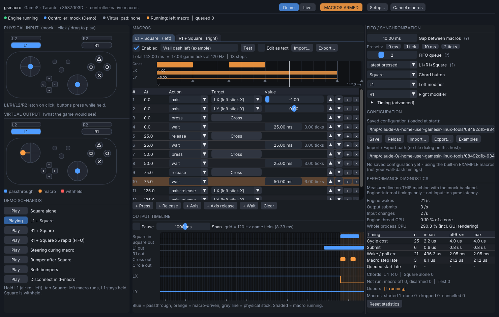

# gsmacro: low-latency controller macros for the GameSir Tarantula

A small, portable Windows tool. It passes your GameSir controller through to
a virtual Xbox 360 pad with minimal added processing, and adds
**controller-native** Rocket League macros (never keyboard or mouse
emulation):

* **L1 / R1**: air roll, always passed through.
* **Square alone**: passed through in the same sample. Nothing waits for a
  possible chord.
* **L1 held + Square**: left macro. **R1 held + Square**: right macro. Only
  the Square press that triggers a macro is withheld.
* Macros can press, release or suppress buttons, set sticks and triggers,
  and wait any number of milliseconds (fractions allowed).
* Activations run **FIFO**, never overlapping, with a configurable gap
  (0 ms allowed).

> **Status: built and tested offline only.** The real controller, ViGEmBus
> and HidHide path has **not** been run on hardware yet. Start with
> [docs/SETUP.md](docs/SETUP.md) and
> [docs/HARDWARE-CHECKLIST.md](docs/HARDWARE-CHECKLIST.md). Nothing here
> claims real-hardware compatibility or input-to-game latency.



## Portable release (Windows x64)

`gsmacro-windows-x64.zip` needs no installer, Visual Studio, .NET or VC++
runtime:

| File | Purpose |
|---|---|
| `gsmacro.exe` | The application (Demo Mode, Live Mode, guided setup) |
| `ViGEmClient.dll` | ViGEm user-mode client v1.21.222.0, compiled unmodified from the [official source](https://github.com/nefarius/ViGEmClient) (MIT) |
| `gsm_bench.exe` | Software timing measurements (see [docs/BENCHMARKING.md](docs/BENCHMARKING.md)) |
| `gsm_tests.exe` | The automated test suite (run it on the target PC first) |
| `diagnostics\gsprobe\` | Read-only HID/XInput probe and inspection scripts from the earlier investigation |
| `examples\*.cfg` | Example configurations |
| `docs\`, `screenshots\`, `licenses\`, `THIRD_PARTY_NOTICES.txt`, `BUILD-INFO.txt`, `SHA256SUMS.txt` | Guides, licenses, provenance |

gsmacro never installs or removes drivers. It never changes HidHide, reWASD,
GameSir Connect, or the controller's firmware or profiles. Its only file is
`%APPDATA%\gsmacro\gsmacro.cfg`.

## Architecture (unchanged from the previous round, extended)

```
 GameSir ─XInput(poll)─▶ IInputSource ─┐                   ┌─▶ IOutputSink ─▶ ViGEm virtual X360 ─▶ game
                                       ▼   Engine thread    │
              wait(min(next macro event, next poll | input event))   (HR waitable timer + MMCSS on Windows)
                                       │
               read ─▶ Processor ─▶ submit only on change
                        │ chord detector (L1/R1 held + Square edge; armed switch)
                        │ MacroScheduler: FIFO ring, absolute deadlines, release update between macros
                        └ merge: (phys & ~withheld & ~suppressed) | forced; axis overrides
 GUI thread ◀── snapshot (engine try-locks, never waits) + lock-free timeline ring
```

* **Core** (`core/`): portable and allocation-free per sample. Fully covered
  by tests with a fake clock.
* **Windows backends** (`backends/win/`):
  * `XInputSource` picks the pad by VID 3537, so it can never read its own
    virtual pad.
  * `ViGEmSink` loads `ViGEmClient.dll` at run time. Its declarations were
    checked against the official v1.21.222.0 headers.
  * `WinWaiter` uses a high-resolution waitable timer and MMCSS "Games".
  * The HidHide status check is read-only.
* **GUI** (`app/`): Dear ImGui 1.91.9 (vendored, MIT), on Win32 + DX11.
  There's also a GLFW host used for development and screenshots.

## What changed in this round

**Macro execution**
* The gap between queued macros can be 0 ms.
* Ending a macro always produces one update with every override released
  before the next macro starts, so press/release edges are never merged. Only
  a gap of at least one game tick guarantees the game *samples* that release;
  the GUI warns about this.
* New master switch: **macros armed / off**. Live Mode always starts OFF
  (pure passthrough).
* **Test** buttons run a macro through the FIFO without a chord.
* Stopping or destroying the engine always leaves the virtual pad neutral.
* A failed output submit is retried instead of being forgotten.
* The validator flags re-pressing a button at the instant it was released.
* Duplicate macro sections in a config file are rejected.
* Fixed `VIGEM_ERROR_BUS_VERSION_MISMATCH` (was `0xE000000E`; the official
  value is `0xE0000008`).

**GUI**
* Status bar: controller, virtual pad slot, ViGEmBus, HidHide, macros
  armed/off.
* Guided **Setup & validation** window (8 steps, read-only checks, explicit
  buttons for anything that acts).
* Per-macro visual timeline with **draggable wait handles** (Shift snaps to
  120 Hz game ticks), and the running step highlighted.
* Import/export of whole configs and single macros, with native file
  dialogs on Windows.
* Live passthrough self-test: the virtual pad is read back through XInput
  and compared with gsmacro's output.
* Error dialogs with recovery steps.
* Live FIFO queue view in Diagnostics.

**Benchmarking:** `gsm_bench` has new modes:
* `mock`: processing, output, macro edge timing, FIFO behaviour, jitter, CPU
* `slots`: list XInput slots
* `poll`: read-only polling of the real controller
* `capture`: record any XInput pad and report per-edge timing (the reWASD
  comparison)
* `live`: the full pipeline with readback

## Build from source

The release is cross-compiled reproducibly on Linux (no Windows needed):

```sh
tools/windows/gsmacro/packaging/build-release.sh dist/
# → dist/gsmacro-windows-x64.zip (+ .sha256)
```

The script fetches ViGEmClient at tag `v1.21.222.0` and checks the commit
hash before building it. MSVC also works (CMake ≥ 3.16):

```bat
cmake -S tools\windows\gsmacro -B build -G "Visual Studio 17 2022" -A x64
cmake --build build --config Release
```

For a Linux development build (Demo Mode only), run
`cmake -S tools/windows/gsmacro -B build -G Ninja && ninja -C build`, then:

* `./build/gsm_tests`
* `./build/gsm_bench mock`
* `xvfb-run ./build/gsmacro --screenshots DIR`

## Verification done offline

| Check | Result |
|---|---|
| `gsm_tests`: 72 cases. Chords, Square suppression, simultaneous bumpers, timing, zero-gap transitions, rapid activation, FIFO order, cancel, disconnect/reconnect, shutdown, config validation, example configs, edge analysis | **72/72**: Linux (repeated), under all-cores CPU saturation (5 runs), ThreadSanitizer (3 runs, 0 reports), ASan + UBSan (3 runs, 0 reports) |
| Windows build (MinGW-w64 cross-compile) | GUI, bench and tests build with 0 warnings in project code; static, system DLLs only |
| Windows `gsm_tests.exe` under Wine 9.0 | **72/72** |
| `ViGEmClient.dll` (built from official source) under Wine | Loads, exports the full official API, `vigem_alloc`/`vigem_connect` work and return the documented `0xE0000001` (bus not found) on a machine without ViGEmBus |
| Windows GUI under Wine | Starts, opens the first-run setup, shows real check results and guidance (`screenshots/10-...`) |
| GUI screenshots | `docs/screenshots/` (Linux build under Xvfb + Windows build under Wine) |

**Not verifiable here:** anything involving the real controller, the
ViGEmBus driver, HidHide, XInput readback of the virtual pad, rumble, or
Rocket League. Wine's `xinput1_4.dll` also lacks the ordinal exports gsmacro
needs, so the XInput paths stop with a clear message there (real
Windows 10/11 has them).

## Numbers measured offline (cloud VM, mock backend, not your PC)

Representative `gsm_bench mock` results on a 4-vCPU shared cloud VM (Linux).
Software floor only: **not** Windows figures and **not** input-to-game
latency. Millisecond outliers are VM scheduling stalls and varied between
runs.

| Measurement | Result |
|---|---|
| Engine cycle (read + process + submit) | mean ≈ 3 µs |
| Input change → submit, event-driven | mean ≈ 75 µs, p50 ≤ 100 µs |
| Macro step lateness, spin tail 300 µs | p50 ≤ 2 µs; mean 6–770 µs depending on VM stalls |
| Macro edges vs schedule (8.333 ms steps, delivered output) | typically within 0.01 ms; occasional VM stalls |
| FIFO: 10 presses in 20 ms, capacity 2 | 3 run (order L R L), 7 dropped, start-to-start error < 1 µs |
| Engine CPU idle, event-driven / polled every 500 µs | 0.13 % / 5 % of one core |

## Hardware-dependent tasks remaining

See [docs/HARDWARE-CHECKLIST.md](docs/HARDWARE-CHECKLIST.md) for the full
list. In short:

1. Detection of the real pad (XInput VID 3537) and polling behaviour
   (`gsm_bench poll`, gsprobe).
2. Creating and removing the ViGEm virtual pad; XInput readback self-test.
3. Passthrough of every control in `joy.cpl`; rumble pass-through.
4. HidHide hiding: exactly one controller visible to games, and undo.
5. Your real reWASD macro timings entered and compared (`gsm_bench capture`
   on both).
6. Timing on your PC (`gsm_bench mock` / `live`), and the spin-tail choice.
7. Disconnect/replug in Live Mode.
8. End-to-end latency with a high-speed camera; Rocket League free play.

## Known limitations

* Input is polled from XInput (default 500 µs, so about 250 µs average
  sampling delay). An event-driven HID wake waits on gsprobe data from your
  PC.
* A press shorter than one poll period can be missed (true of any polled
  reader).
* A 0 ms gap between macros can't guarantee the game sees the release
  between them. The game samples at 120 Hz.
* "Square, then bumper" never triggers (by design: no added Square delay).
* A dropped activation (queue full) still withholds that Square press,
  because a macro was intended.
* The exe and DLL are unsigned, so SmartScreen may warn. `SHA256SUMS.txt` is
  provided.
* ViGEmBus is retired upstream, but it is what your PC already has
  installed.
