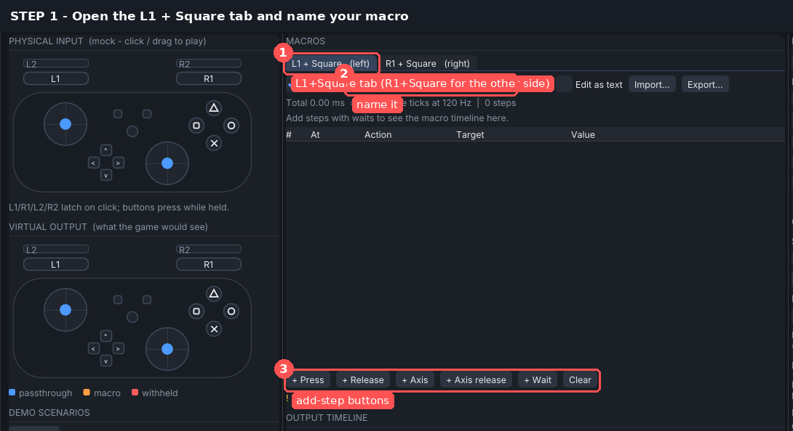
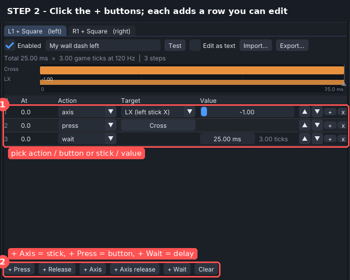
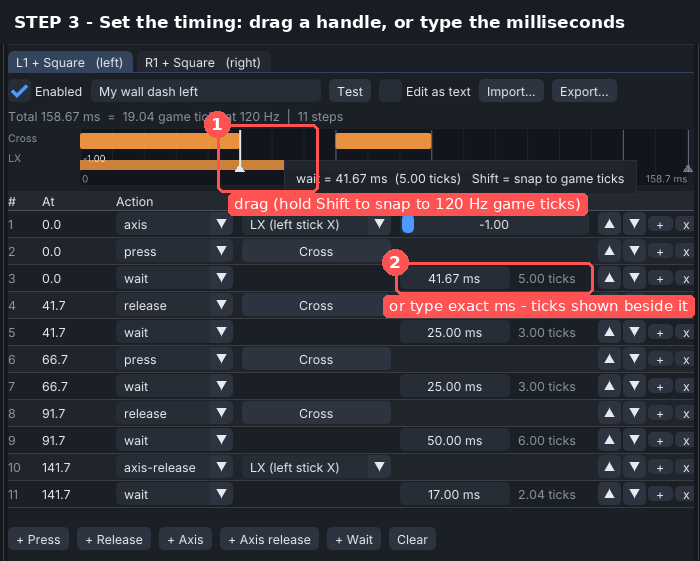
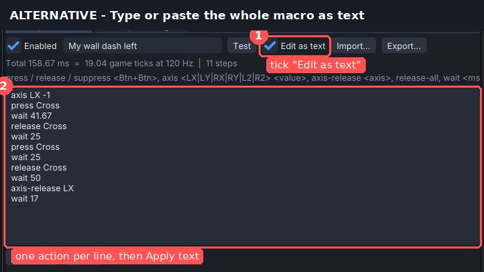
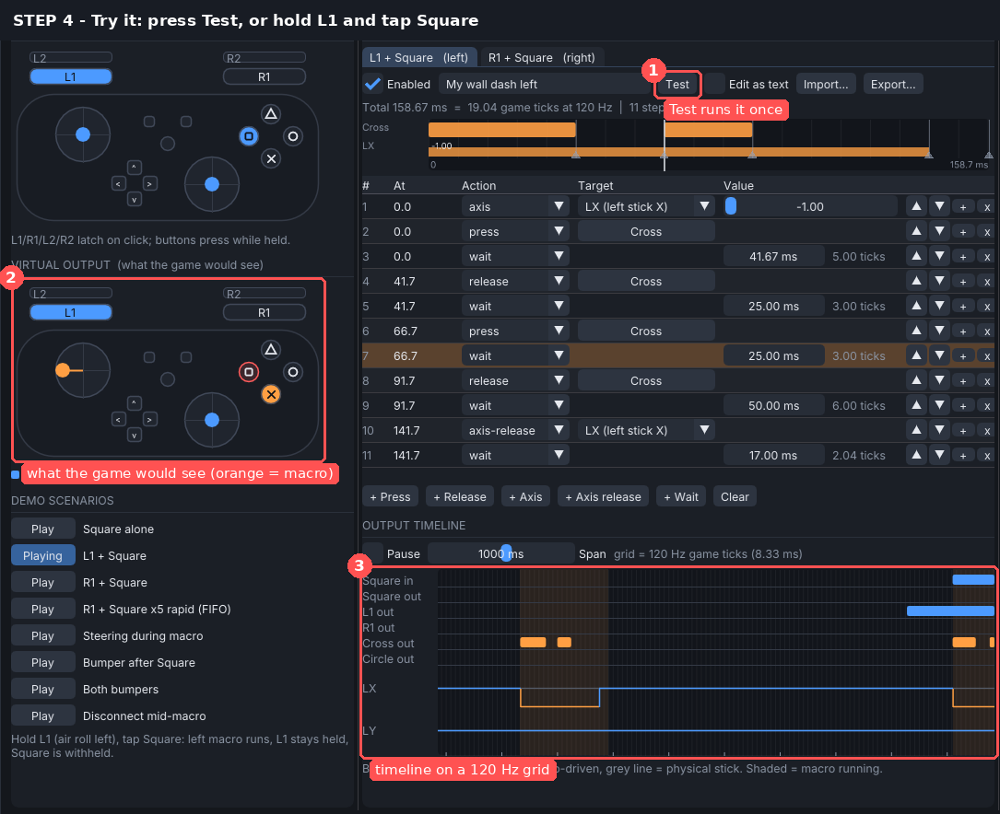
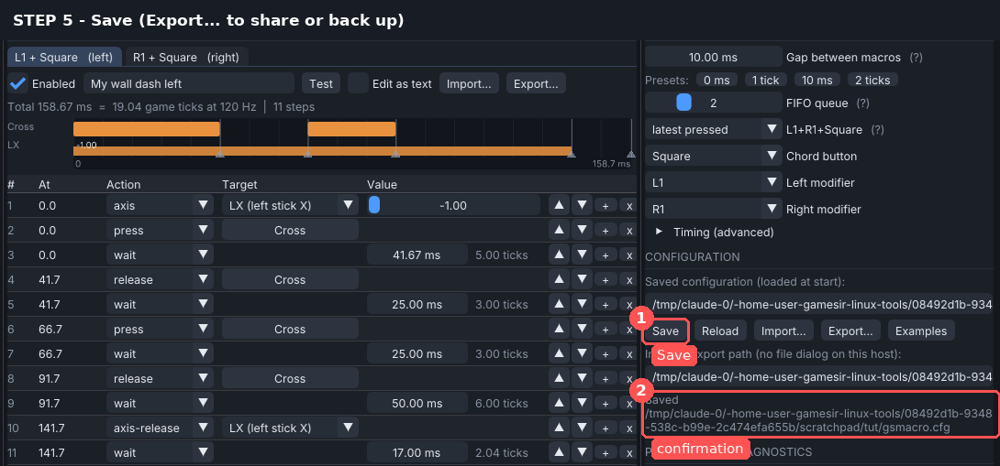

# Making a macro (about 2 minutes)

These screenshots come from the real app, driven by a script (`gsmacro --tutorial DIR`).
The drag in step 3 is a real mouse drag injected into the GUI. Demo Mode was used,
so no controller was needed.

1. **Open the tab and name the macro.**
   Use **L1 + Square** for the left macro and **R1 + Square** for the right one.
   
2. **Add steps with the + buttons.**
   - **+ Axis** sets a stick or trigger.
   - **+ Press** and **+ Release** control a button.
   - **+ Wait** adds a delay.

   Each button adds a row you can edit.
   
3. **Set the timing.**
   Drag a wait handle on the timeline (hold **Shift** to snap to 120 Hz game ticks),
   or type the exact milliseconds into the row.
   
   *Alternative:* tick **Edit as text** and type or paste one action per line
   (for example copied from your reWASD macro), then click **Apply text**.
   
4. **Try it.**
   Click **Test**, or hold L1 and tap Square.
   The *virtual output* pad and the timeline show exactly what the game would receive.
   
5. **Save.** Use **Export...** to keep a copy or share it.
   

Text format reference:

| Line | Meaning |
|---|---|
| `press Cross` / `release Cross` | Hold / let go of a button. Combine buttons with `+`, e.g. `press Cross+Square`. |
| `suppress L1` | Hide a button you are physically holding until `release L1`. |
| `axis LX -1` | Push a stick (-1 to 1) or trigger (`L2`/`R2`, 0 to 1). |
| `axis-release LX` | Give the stick back to your thumb. |
| `wait 16.67` | Delay in milliseconds (fractions allowed; 8.333 ms = 1 game tick). |

Anything a macro still holds is released automatically when the macro ends.
